# Arsitektur Catu Daya (Dual Power Supply Unit) - Simulator PLTN PWR v5.0

> **Dokumen Teknis:** Distribusi Daya, Pemetaan Pin I/O, dan Prosedur Diagnostik Kelistrikan.  
> **Arsitektur:** Single Controller (Raspberry Pi 4 Master).  
> **Status:** Aktif (v5.0).

---

## 1. Prinsip Desain Kelistrikan

Sistem simulator PLTN menggunakan **dua Power Supply Unit (PSU) eksternal independen** di luar catu daya USB-C Raspberry Pi 4. Pemisahan domain daya ini dilakukan untuk mencegah:
1. **Interferensi Induktif (*Inductive Back-EMF*):** Lonjakan tegangan transien dan derau (*noise*) dari motor DC pompa/turbin masuk ke jalur logika digital.
2. **Kelebihan Beban Regulator (*Overcurrent Brownout*):** Penarikan arus tinggi dari ratusan LED addressable WS2812B dan torsi servo motor yang melampaui kapasitas regulator internal Raspberry Pi (maksimum rail 5V RPi hanya ~1.2A).

```
                      ┌────────────────────────────┐
                      │    SUMBER AC 220V / 50Hz   │
                      └──────┬──────────────┬──────┘
                             │              │
            ┌────────────────▼─────┐  ┌─────▼────────────────┐
            │        PSU 1         │  │        PSU 2         │
            │     12V DC / 5A-10A  │  │    5V DC / 10A-30A   │
            │ (Beban Induktif Motor│  │ (LED, Servo, Relay)  │
            └────────────┬─────────┘  └─────┬────────────────┘
                         │ +12V             │ +5V
                         │                  │
         ┌───────────────┼──────────┐       ├────────────────┬────────────────┐
         │               │          │       │                │                │
         ▼               ▼          │       ▼                ▼                ▼
   ┌───────────┐   ┌───────────┐    │ ┌───────────┐    ┌───────────┐    ┌───────────┐
   │ Driver 1  │   │ Driver 2  │    │ │ LED Strip │    │ 3× Servo  │    │ 4× Relay  │
   │ (L298N /  │   │ (L298N /  │    │ │  WS2812B  │    │  Batang   │    │Humidifier │
   │ VNH2SP30) │   │ VNH2SP30) │    │ │ 444+ LEDs │    │  Kendali  │    │  (CT1-4)  │
   └─────┬─────┘   └─────┬─────┘    │ └─────┬─────┘    └─────┬─────┘    └─────┬─────┘
         │ PWM           │ PWM      │       │ DIN            │ PWM            │ Trigger
         │ (3.3V)        │ (3.3V)   │       │ (3.3V)         │ (3.3V)         │ (Active-LOW)
         │               │          │       │                │                │
   ┌─────┴───────────────┴──────────┴───────┴────────────────┴────────────────┴─────┐
   │                            RASPBERRY PI 4 MASTER                               │
   │              (Daya Logika disuplai terpisah via USB-C 5V 3A)                   │
   │                                                                                │
   │  COMMON GROUND: Seluruh pin -V/GND (PSU1, PSU2, RPi) WAJIB DIJUMPER BERSAMA    │
   └────────────────────────────────────────────────────────────────────────────────┘
```

### Aturan Emas Kelistrikan
* **Common Ground Wajib:** Terminal minus/GND dari PSU 1 (12V), PSU 2 (5V), dan Raspberry Pi **wajib disambungkan bersama secara fisik (*star grounding*)**. Tanpa referensi 0V yang sama, sinyal PWM dan logika kontrol akan mengalami floating, distorsi, atau tidak terbaca sama sekali.
* **Isolasi Tegangan Positif:** Jalur positif **+12V (PSU 1) dan +5V (PSU 2) DILARANG KERAS bersentuhan atau dihubungkan ke satu busbar**. 
* **Perlindungan Pin RPi:** Tegangan +12V tidak boleh menyentuh pin GPIO mana pun pada Raspberry Pi. Toleransi GPIO Raspberry Pi adalah logika 3.3V LVCMOS (maksimal input 3.6V).

---

## 2. Diagram Blok & Pengkabelan Lengkap

```mermaid
flowchart TD
    subgraph AC_MAINS["Sumber Listrik"]
        AC["Jala-Jala PLN 220V AC"]
    end

    subgraph POWER_SUPPLIES["Unit Catu Daya (PSU)"]
        PSU1["PSU 1: 12V DC (5A - 10A)<br/>Switching Industrial SMPS"]
        PSU2["PSU 2: 5V DC (10A - 30A)<br/>High Current SMPS"]
        RPi_PWR["Adaptor Resmi USB-C: 5V 3A"]
    end

    subgraph CONTROLLER["Pengendali Utama"]
        RPi["Raspberry Pi 4 Model B<br/>(Single Controller Architecture)"]
    end

    subgraph ACTUATORS_12V["Domain Beban 12V (PSU 1)"]
        MD1["Motor Driver 1 (L298N / VNH2SP30)"]
        MD2["Motor Driver 2 (L298N / VNH2SP30)"]
        M_P1["Pompa Primer (DC 12V)"]
        M_P2["Pompa Sekunder (DC 12V)"]
        M_P3["Pompa Tersier (DC 12V)"]
        M_TURB["Motor Turbin (DC 12V)"]
    end

    subgraph ACTUATORS_5V["Domain Beban 5V (PSU 2)"]
        STRIP["WS2812B LED Strip (444 LEDs)<br/>Pipa & Pressurizer"]
        SRV_SAF["Servo Safety Rod (MG995/MG996R)"]
        SRV_SHM["Servo Shim Rod (MG995/MG996R)"]
        SRV_REG["Servo Regulating Rod (MG995/MG996R)"]
        RELAY["Modul Relay 4-Channel (Active LOW)"]
        HUMID["4× Humidifier Ultrasonic (CT1-CT4)"]
        BUF["Buffer / Level Shifter 74HC245N"]
        LEDS["LED Indikator Status & Cherenkov"]
    end

    AC --> PSU1
    AC --> PSU2
    AC --> RPi_PWR
    RPi_PWR -->|USB-C 5V| RPi

    %% PSU 1 Wiring
    PSU1 -->|+12V Power| MD1
    PSU1 -->|+12V Power| MD2
    MD1 --> M_P1
    MD1 --> M_P2
    MD2 --> M_P3
    MD2 --> M_TURB

    %% PSU 2 Wiring
    PSU2 -->|+5V VCC| STRIP
    PSU2 -->|+5V VCC| SRV_SAF
    PSU2 -->|+5V VCC| SRV_SHM
    PSU2 -->|+5V VCC| SRV_REG
    PSU2 -->|+5V VCC| RELAY
    PSU2 -->|+5V VCC| BUF
    RELAY --> HUMID
    BUF --> LEDS

    %% RPi Control Signals
    RPi -->|GPIO 17 PWM| MD1
    RPi -->|GPIO 20 PWM| MD1
    RPi -->|GPIO 27 PWM| MD2
    RPi -->|GPIO 26 PWM| MD2

    RPi -->|GPIO 18 PWM0/DMA| STRIP
    RPi -->|GPIO 23 PWM| SRV_SAF
    RPi -->|GPIO 24 PWM| SRV_SHM
    RPi -->|GPIO 25 PWM| SRV_REG
    RPi -->|GPIO 2,3,9,22| RELAY
    RPi -->|GPIO 5,6,12,13,16| BUF

    %% Common Ground Connections
    PSU1 -.->|GND Common| CG[("COMMON GROUND BUS")]
    PSU2 -.->|GND Common| CG
    RPi -.->|GND Pin 6/14/20| CG
    MD1 -.->|GND| CG
    MD2 -.->|GND| CG
    STRIP -.->|GND| CG
    SRV_SAF -.->|GND| CG
    SRV_SHM -.->|GND| CG
    SRV_REG -.->|GND| CG
    RELAY -.->|GND| CG
    BUF -.->|GND| CG
```



---

## 3. Spesifikasi Beban & Karakteristik Arus

### 3.1 PSU 1: Domain 12V DC (Beban Dinamis Induktif)
* **Tipe PSU:** SMPS 12V DC (disarankan rating **12V 5A – 10A**, minimum 60W – 120W).
* **Terminal Keluaran:** `+12V` dan `-V / GND`.

| Modul / Komponen | Jumlah | Rating Tegangan | Arus Operasional (Typ) | Arus Puncak (Stall/Start) | Total Daya (Max) | Keterangan Sambungan |
| :--- | :---: | :---: | :---: | :---: | :---: | :--- |
| **Pompa Primer** | 1 | 12V DC | 0.8A | 1.8A | 21.6W | Output Driver 1 (OUT1/OUT2) |
| **Pompa Sekunder** | 1 | 12V DC | 0.8A | 1.8A | 21.6W | Output Driver 1 (OUT3/OUT4) |
| **Pompa Tersier** | 1 | 12V DC | 0.8A | 1.8A | 21.6W | Output Driver 2 (OUT1/OUT2) |
| **Motor Turbin** | 1 | 12V DC | 0.6A | 1.5A | 18.0W | Output Driver 2 (OUT3/OUT4) |
| **Total Estimasi** | **4 Motor** | **12V DC** | **~3.0A** | **~6.9A (Inrush)** | **~82.8W** | Membutuhkan PSU min. 12V 5A (ideal 12V 10A) |

### 3.2 PSU 2: Domain 5V DC (Beban Logika & Arus Tinggi)
* **Tipe PSU:** SMPS 5V DC (disarankan rating **5V 15A – 30A**, minimum 75W – 150W).
* **Terminal Keluaran:** `+5V` dan `-V / GND`.

| Modul / Komponen | Jumlah | Rating Tegangan | Arus Operasional (Typ) | Arus Puncak (Peak) | Total Daya (Max) | Keterangan Sambungan |
| :--- | :---: | :---: | :---: | :---: | :---: | :--- |
| **WS2812B LED Strip** | 444 LED | 5V DC | ~4.5A (Animasi Aliran) | ~26.6A (100% White) | ~133W (Peak) | Injeksi daya dari PSU 2 di kedua ujung strip |
| **Servo Rods** (Safety, Shim, Regulating) | 3 | 5V DC | ~0.6A (Hold) | ~2.5A (Moving) | 12.5W | Daya langsung dari busbar 5V PSU 2 |
| **Modul 4-Relay Humidifier** | 1 Board | 5V DC | ~0.2A (All Coils ON) | ~0.3A | 1.5W | VCC ke PSU 2 |
| **Level Shifter 74HC245N & Indikator** | 1 Set | 5V DC | ~0.1A | ~0.2A | 1.0W | VCC ke PSU 2 |
| **Total Estimasi** | - | **5V DC** | **~6.0A** | **~29.6A (Full White)** | **~148W** | Membutuhkan PSU min. 5V 15A – 20A |

---

## 4. Pemetaan Lengkap Pin I/O Kontrol (Raspberry Pi 4)

Semua sinyal kontrol berasal dari pin GPIO Raspberry Pi 4 dengan level logika 3.3V. Sinyal dikirimkan langsung ke modul aktuator yang ditenagai oleh masing-masing PSU.

| Fungsi Kontrol | Komponen Fisik | Pin GPIO (BCM) | Pin Fisik Raspberry Pi | Domain Daya Modul | Level Logika | Pengendali Software |
| :--- | :--- | :---: | :---: | :---: | :---: | :--- |
| **PWM Pompa Primer** | Driver Motor #1 (ENA) | **GPIO 17** | Pin 11 | **PSU 1 (12V)** | 3.3V PWM (5kHz) | `MotorController.set_speed()` |
| **PWM Pompa Sekunder** | Driver Motor #1 (ENB) | **GPIO 20** | Pin 38 | **PSU 1 (12V)** | 3.3V PWM (5kHz) | `MotorController.set_speed()` |
| **PWM Pompa Tersier** | Driver Motor #2 (ENA) | **GPIO 27** | Pin 13 | **PSU 1 (12V)** | 3.3V PWM (5kHz) | `MotorController.set_speed()` |
| **PWM Motor Turbin** | Driver Motor #2 (ENB) | **GPIO 26** | Pin 37 | **PSU 1 (12V)** | 3.3V PWM (5kHz) | `MotorController.set_speed()` |
| **Data Flow LED Strip** | WS2812B (DIN) | **GPIO 18** | Pin 12 | **PSU 2 (5V)** | 3.3V Data (PWM0/DMA10) | `LedStripController` |
| **PWM Servo Safety Rod** | Servo Motor 1 (Signal) | **GPIO 23** | Pin 16 | **PSU 2 (5V)** | 3.3V PWM (50Hz) | `ServoController.set_rods()` |
| **PWM Servo Shim Rod** | Servo Motor 2 (Signal) | **GPIO 24** | Pin 18 | **PSU 2 (5V)** | 3.3V PWM (50Hz) | `ServoController.set_rods()` |
| **PWM Servo Regulating** | Servo Motor 3 (Signal) | **GPIO 25** | Pin 22 | **PSU 2 (5V)** | 3.3V PWM (50Hz) | `ServoController.set_rods()` |
| **Trigger Relay CT1** | Modul Relay (IN1) | **GPIO 2** | Pin 3 | **PSU 2 (5V)** | 3.3V Active-LOW | `RelayController.set_relays()` |
| **Trigger Relay CT2** | Modul Relay (IN2) | **GPIO 3** | Pin 5 | **PSU 2 (5V)** | 3.3V Active-LOW | `RelayController.set_relays()` |
| **Trigger Relay CT3** | Modul Relay (IN3) | **GPIO 9** | Pin 21 | **PSU 2 (5V)** | 3.3V Active-LOW | `RelayController.set_relays()` |
| **Trigger Relay CT4** | Modul Relay (IN4) | **GPIO 22** | Pin 15 | **PSU 2 (5V)** | 3.3V Active-LOW | `RelayController.set_relays()` |
| **PWM Daya Output** | Power Indicator LED | **GPIO 13** | Pin 33 | **PSU 2 (5V)** | 3.3V PWM (via Buffer) | `ActuatorManager` |
| **PWM Cherenkov** | Cherenkov Blue LED | **GPIO 16** | Pin 36 | **PSU 2 (5V)** | 3.3V PWM (via 74HC245) | `ActuatorManager` |
| **PWM Turbin Ambience** | Turbine Light LED | **GPIO 12** | Pin 32 | **PSU 2 (5V)** | 3.3V PWM (via 74HC245) | `ActuatorManager` |
| **Relief Valve Normal** | Green Status LED | **GPIO 5** | Pin 29 | **PSU 2 (5V)** | 3.3V Digital OUT | `ActuatorManager` |
| **Relief Valve Open** | Red Status LED | **GPIO 6** | Pin 31 | **PSU 2 (5V)** | 3.3V Digital OUT | `ActuatorManager` |
| **Common Ground** | Ground Bus | **GND** | Pin 6, 14, 20 | **Semua PSU** | 0V Referensi | Referensi bersama |

---

## 5. Analisis Penyebab Hubung Singkat (Short Circuit)

Saat terjadi hubungan singkat (hambatan < 0.5 Ω antara kutub positif dan GND), sirkuit proteksi internal SMPS (**Short Circuit Protection / Over Current Protection**) langsung aktif. Gejalanya:
- Lampu indikator LED pada bodi PSU mati atau berkedip-kedip cepat (*hiccup mode*).
- PSU mengeluarkan suara *clicking* berulang.
- Tegangan output drop seketika ke 0.0V sehingga seluruh sistem yang disuplai padam.

### 5.1 Matriks Titik Rawan Short Circuit

```
┌──────────────────────────────────────────────────────────────────────────────┐
│                  DAFTAR TERSANGKA UTAMA SHORT CIRCUIT                        │
├───────────────────┬───────────────────────────────┬──────────────────────────┤
│ Komponen Target   │ Titik Rentan                  │ Tingkat Probabilitas     │
├───────────────────┼───────────────────────────────┼──────────────────────────┤
│ Strip LED WS2812B │ Sambungan solder sambungan    │ SANGAT TINGGI (80%)      │
│ (PSU 2 - 5V)      │ antar segmen di dalam pipa    │                          │
├───────────────────┼───────────────────────────────┼──────────────────────────┤
│ Driver L298N/VNH  │ H-Bridge jebol (punch-through)│ TINGGI (15%)             │
│ (PSU 1 - 12V)     │ terminal 12V tembus ke GND    │                          │
├───────────────────┼───────────────────────────────┼──────────────────────────┤
│ 3× Servo Motor    │ Gear macet / lilitan koil     │ SEDANG (5%)              │
│ (PSU 2 - 5V)      │ terbakar akibat stall torque  │                          │
├───────────────────┼───────────────────────────────┼──────────────────────────┤
│ Modul Relay       │ Dioda flyback short /         │ RENDAH (<2%)             │
│ (PSU 2 - 5V)      │ rembesan air humidifier       │                          │
└───────────────────┴───────────────────────────────┴──────────────────────────┘
```

1. **Jalur WS2812B (Tersangka Utama di PSU 2):**
   - Rangkaian 444 LED dipasang melingkar di dalam pipa akrilik (Primer, Sekunder, Tersier, Kondenser, Pressurizer).
   - Jalur tembaga pada strip fleksibel sangat rentan terjepit atau terkelupas isolasinya ketika ditarik melalui siku pipa simulator.
   - Titik solder kabel sambungan antar segmen (+5V dan GND) berjarak kurang dari 1.5 mm dan mudah bersentuhan jika terkena tarikan mekanis atau rangka simulator.
2. **Driver L298N / VNH2SP30 (Tersangka Utama di PSU 1):**
   - Transistor bipolar atau MOSFET internal pada H-Bridge dapat mengalami *punch-through* (rusak permanen) jika motor dipaksa berhenti mendadak saat kecepatan tinggi tanpa rangkaian peredam tegangan induktif yang memadai.
   - Jika H-Bridge jebol, pin input `+12V` terhubung langsung (0 Ω) ke `GND`.
3. **Servo Motor Control Rods:**
   - Batang kendali yang terbentur rangka fisik dapat menyebabkan servo tertahan pada posisi sudut ekstrem (*mechanical stall*). Kondisi ini menarik arus >2.5A secara kontinu hingga koil motor terbakar dan terjadi korsleting internal.

---

## 6. Prosedur Diagnostik & Isolasi Masalah

Ikuti urutan langkah berikut untuk melacak komponen yang korslet tanpa risiko merusak Raspberry Pi:

### Tahap 1: Pengujian Mandiri PSU (No-Load Test)
1. **Putuskan seluruh kabel output DC:** Lepas kabel `+12V` dari PSU 1 dan `+5V` dari PSU 2 sehingga terminal output kedua PSU benar-benar kosong.
2. **Nyalakan sumber listrik 220V AC:**
   - Periksa lampu LED indikator pada masing-masing PSU.
   - Ukur dengan multimeter DC:
     - Output PSU 1 harus stabil di **12.0V ± 0.3V**.
     - Output PSU 2 harus stabil di **5.0V ± 0.2V**.
   - *Hasil Analisis:* Jika salah satu PSU tidak menyala atau tegangannya 0V meskipun tanpa beban, maka PSU tersebut rusak internal (ganti PSU). Jika tegangan normal, lanjutkan ke Tahap 2.

### Tahap 2: Pengukuran Resistansi Bus (Kondisi Listrik OFF)
1. **Matikan sumber 220V AC sepenuhnya.**
2. Atur multimeter ke mode **Buzzer / Continuity / Resistance (Ω)**.
3. Ukur hambatan antara kabel rel positif dan kabel rel ground pada masing-masing domain beban:
   - **Domain 12V (Kabel bus +12V ke Common Ground):** Nilai normal > 100 Ω. Jika terukur **0.0 Ω – 1.0 Ω (buzzer berbunyi)**, korsleting berada di jalur 12V.
   - **Domain 5V (Kabel bus +5V ke Common Ground):** Nilai normal puluhan hingga ratusan ohm. Jika terukur **0.0 Ω – 0.8 Ω (buzzer berbunyi)**, korsleting berada di jalur 5V.

### Tahap 3: Isolasi Komponen Bertahap
Setelah mengetahui jalur mana yang korslet (12V atau 5V), cabut modul satu per satu sambil memperhatikan tampilan multimeter:

* **Jika short terjadi pada jalur 5V (PSU 2):**
  1. **Cabut kabel daya LED Strip WS2812B:** Amati multimeter. Jika resistansi langsung naik ke normal (buzzer berhenti), titik korslet ada pada sambungan solderan atau tekukan strip LED di pipa.
  2. **Cabut 3 kabel servo (GPIO 23, 24, 25):** Cabut konektor 3-pin servo satu per satu. Jika korslet hilang saat servo tertentu dicabut, servo tersebut terbakar internal.
  3. **Cabut kabel VCC modul relay 4-channel.**
* **Jika short terjadi pada jalur 12V (PSU 1):**
  1. **Lepaskan terminal sekrup +12V pada Driver Motor #1 (Pompa 1 & 2):** Periksa apakah resistansi normal.
  2. **Lepaskan terminal sekrup +12V pada Driver Motor #2 (Pompa 3 & Turbin):** Jika resistansi normal setelah dilepas, modul driver tersebut mengalami korsleting internal pada chip H-Bridge.
  3. **Lepaskan kabel motor satu per satu dari terminal OUT1–OUT4.**

Setelah titik hubungan singkat diperbaiki dan resistansi jalur terkonfirmasi tidak nol, barulah sambungkan kembali sistem ke catu daya utama.
